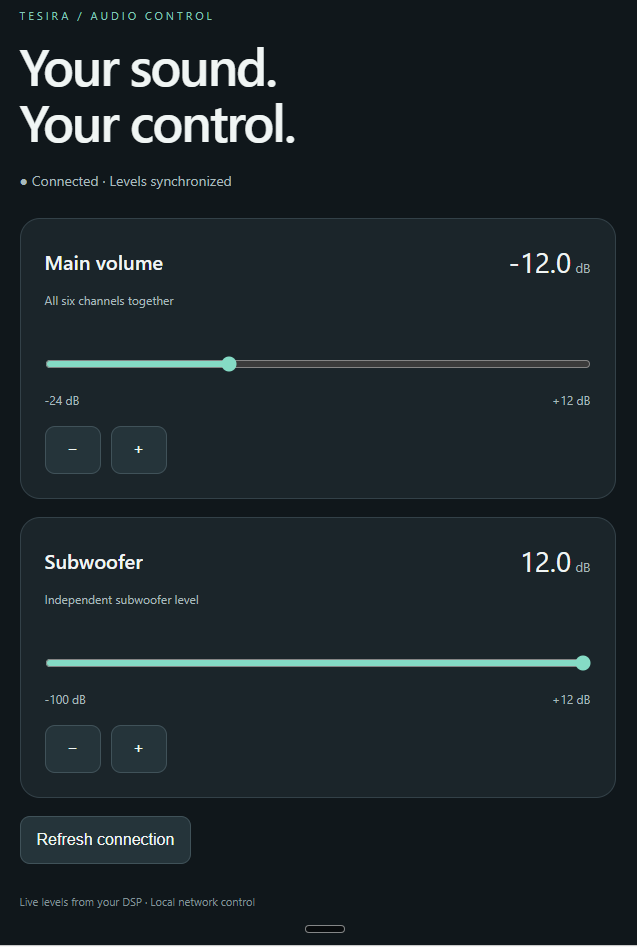

# Tesira Web Control

A mobile-friendly dashboard for main and subwoofer volume on a Biamp Tesira DSP. Runs as one Docker container on Unraid, with no runtime npm dependencies.

## Why this exists

Biamp Canvas is Windows-only control software, so its control surfaces cannot run natively on iPads, iPhones, or Android phones. I wanted a simple way to adjust my Tesira system from my phone without opening a Windows computer.

Tesira Web Control provides a browser-based dashboard hosted on my Unraid server. The server communicates directly with the DSP using Tesira Text Protocol (TTP), while a phone or tablet only needs a browser on the local network. The initial goal is straightforward: main and subwoofer volume control, with preset buttons planned for later.

Biamp's [Canvas system requirements](https://canvas-help.biamp.com/Biamp_Canvas_Help/Introduction/Architect_and_Engineer_Specification.html) list Windows as the supported operating system. This dashboard is an independent project focused on a small set of everyday controls.

## Status

Working on the target Unraid and Biamp Tesira DSP setup. The owner has confirmed that the dashboard and volume adjustments work properly after the persistent Telnet connection update resolved the earlier delay. No measured hardware latency is claimed.

The automated suite has 18 passing tests covering TTP, refresh behavior, configurable channel targeting, saved settings across restarts, and stale-mapping rejection. The new settings panel and mappings still need verification on physical hardware. Physical disconnect/recovery testing and compatibility with other Tesira designs are not yet confirmed.

## Features

- Editable Main and Subwoofer instance tags (defaults: `Level5` and `Level4`).
- Channel-count dropdowns (1–32) for each group.
- Gang on: one slider sets the selected channels equally. Gang off: individual channel sliders.
- Settings saved across restarts in a persistent Docker volume.
- Large dB readouts, sliders, and 0.5 dB adjustment buttons.
- Current levels read on connection; no startup/reconnect volume defaults.
- Actual values refreshed every three seconds while the page is visible.
- Configurable limits enforced by the backend.
- Readback after writes and clear errors for partial main updates.
- Controls disabled when disconnected or a volume/settings write is in progress.

## Upcoming feature

**Preset selection:** choose and recall saved Tesira presets directly from the dashboard. This feature is planned and is not available yet.

## Screenshot

The running dashboard, showing main and subwoofer volume controls.




## Quick start on Unraid

Run in the Unraid terminal:

```bash
mkdir -p /mnt/user/appdata/tesira-web-control
git clone https://github.com/clausefoto/tesira-web-control.git /mnt/user/appdata/tesira-web-control
cd /mnt/user/appdata/tesira-web-control
cp .env.example .env
nano .env
```

Replace `DSP_HOST=192.0.2.10` with your DSP's actual IP address. Review the volume limits, save, and exit. The example address is deliberately nonfunctional.

Build and launch, without needing the Compose plugin:

```bash
docker build -t tesira-web-control:local .
docker run -d --name tesira-web-control --restart unless-stopped \
  -p 8088:8088 --env-file .env \
  -v tesira-web-control-data:/data tesira-web-control:local
```

Or, if Docker Compose is installed:

```bash
docker compose up -d --build
```

Use one launch method. Open `http://<unraid-address>:8088` on your phone on the home Wi-Fi. Save a home-screen shortcut if desired.

The plain `docker run` command always publishes port 8088; to change it, change its left-hand port number (for example `-p 8090:8088`). `WEB_PORT` in `.env` applies to Compose only.

## First hardware check

1. Open the dashboard and verify its readouts match Tesira. Opening it does not write any settings.
2. Make a small downward sub adjustment and verify it in Tesira.
3. Make a small downward main adjustment and verify all six channels.
4. Change a level in Tesira and confirm the dashboard follows.
5. Test DSP disconnection and recovery.

With Gang on, adjustments set all configured channels in that group to the same value. With Gang off, each channel has its own slider. If channels differ, the dashboard lists them before adjustment. Main channel writes are sequential, not atomic: a failure can leave only some channels changed. The app stops on the first failure, shows an error, and reads actual levels on the next refresh. It never automatically rolls back or retries a volume write.

## Configuration

| Variable | Default | Meaning |
|---|---|---|
| DSP_HOST | documentation-only example address | DSP control-network IP |
| DSP_PORT | 23 | Telnet port |
| WEB_PORT | 8088 | Compose host port |
| PORT | 8088 | App listen port; leave at 8088 in Docker |
| MAIN_MIN_DB / MAIN_MAX_DB | -24 / 12 | Main slider limits |
| SUB_MIN_DB / SUB_MAX_DB | -100 / 12 | Sub slider limits |

Open **Settings** in the dashboard to enter each group’s exact instance tag, choose its channel count, and switch Gang on or off. Channel counts select channels 1 through N; they do not create DSP channels. Gang links the dashboard controls and does not change the DSP block’s own ganging. The defaults preserve the original design: main `Level5` / 6 channels / Gang on; sub `Level4` / 1 channel / Gang on.

Saving settings does not write volume levels to the DSP. Docker stores settings in `/data/settings.json`; preserve the `tesira-web-control-data` volume when recreating the container. Outside Docker, settings use `./data/settings.json`. Set `SETTINGS_FILE` to override the path. Native DSP blocks that require channel index 0 are not supported by this dashboard linking mode.

 Match configured limits to the DSP block limits. Changing `.env` requires recreating the container. Actual addresses and credentials should remain in ignored local files.

## Development

Requires Node.js 22 or newer (Docker uses Node.js 24).

```bash
cp .env.example .env
# Edit DSP_HOST before connecting to hardware.
npm start
npm test
```

Tests cover Telnet negotiation and fragmented replies, read-only startup behavior, all six main writes, independent sub control, invalid input, partial failures, serialized operations, and timeouts.

## Architecture

Phone browser → Node.js HTTP server on Unraid → Tesira Telnet/TTP.

The backend serializes operations over one persistent Telnet session, with TCP_NODELAY enabled. On a timeout or disconnect it discards the session, preventing a late reply from satisfying a later command. Subsequent operations reconnect without automatically replaying writes. State uses periodic reads rather than subscriptions in this version. A main update uses six acknowledged per-channel commands followed by actual level reads.

## Access and troubleshooting

This version has no login and is intended for a trusted local network only. Do not forward the dashboard or DSP Telnet ports to the internet. Telnet traffic is unencrypted.

- Read logs: `docker logs --tail 100 tesira-web-control`
- Verify the DSP address and that Telnet is enabled.
- Check that the container can route to the DSP's control network on TCP port 23.
- A `channelIndex` error means the block/channel mapping is wrong.
- A level-limit error means the requested value is outside the DSP's limits.
- For a partial update, inspect all main channel values before retrying.

See [protocol verification](docs/protocol.md) and [Unraid operations](docs/unraid.md).

[Biamp Tesira Text Protocol reference](https://support.biamp.com/Tesira/Control/Tesira_Text_Protocol).

Independent project; not affiliated with Biamp.
